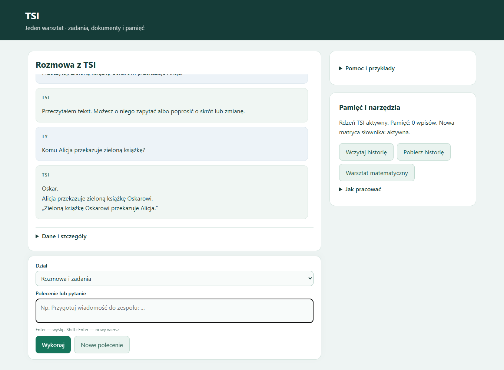
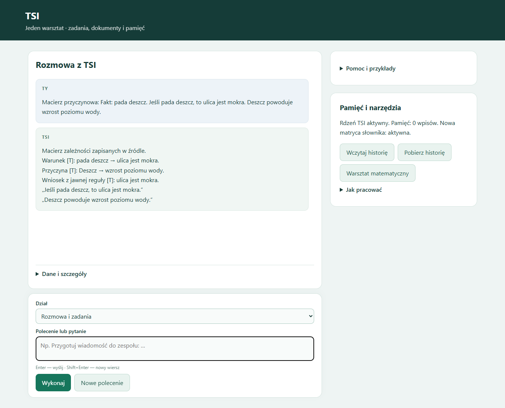

# TSI — lokalny asystent modułowy

**Stan: 19 października 2026.** Własny uczony rdzeń, macierze językowe, trwałe notatki i narzędzia do pracy z tekstem, dokumentami oraz matematyką. Nowa aplikacja zastępuje wcześniejszy AI-SI, zachowany lokalnie w archiwum.

Ta aktualizacja publikuje **samą dokumentację**. Kod nowego TSI, wagi, dane treningowe, dokumenty i prywatna historia pozostają lokalne. Starsze pliki obecne już w repo dotyczą wcześniejszego AI-SI i nie są instalatorem obecnej aplikacji.

## Co działa

| Obszar | Dostępne możliwości |
|---|---|
| Tekst i rozmowa | Czytanie podanego materiału, pytania z cytatem, przygotowanie wiadomości z treści użytkownika, skróty i listy |
| Poprawki | Zamiana wskazanego fragmentu źródła, cofnięcie zmiany, wersjonowanie i nowy temat |
| Dokumenty | TXT, MD, CSV, PDF, DOCX i DOC; pliki lub wklejenie całej treści; do 10 plików, 8 MB na plik i 32 MB łącznie; DOC wymaga Worda, skany wcześniejszego OCR |
| Pamięć | Wspólny kontekst źródeł z pochodzeniem i wersjami, trwałe notatki, historia oraz eksport JSON |
| Matematyka | Arytmetyka słowna w obsługiwanym zakresie, kalkulator naukowy, równania, pochodne, całki, macierze i wykresy |
| Logika i język | Logika trójstanowa, analiza odmiany i ról, kontrola wybranych reguł zapisu oraz ograniczony czytnik PL/EN |
| Audyt odpowiedzi | Przycisk lub rozpoznana prośba o sprawdzenie poprzedniej odpowiedzi; ponowienie obsługiwanych obliczeń i kontrola cytatu w zapisanej wersji źródła |
| Inne narzędzia | Daty, lokalne pliki udostępnione do odczytu, wybrane strony HTTPS i katalog sprawdzonych przykładów programistycznych |

Główny rdzeń H512 ma **2 054 186 parametrów**. Współpracuje z dodatkowymi uczonymi modułami i narzędziami. Aplikacja nie korzysta z Bielika ani Qwena. Notatki i zwykła rozmowa nie uruchamiają samoczynnego treningu wag.

## Wyniki ostatniej partii

- Czytnik audytu: **17/20** nowych próśb ze zmianą szyku; **0/32** błędnych uruchomień dla innych poleceń. Poprzednio wdrożony model na tym samym zestawie: 4/20 i 2/32. Wybrano mniejszy wariant po porównaniu z większym.
- Poprawianie źródła i kontekst: **14/14** szerszych kontroli rozmów, wcześniej 12/14.
- Przeszły też odrębne zestawy: 31 kontroli audytu, 25 regresji, 12 API, 13 odtwarzania/edycji i 5 porównań danych wykresu.

To wyniki konkretnych zestawów, nie procent rozumienia dowolnego języka. [Przebieg treningu, zakresy i porównania](docs/TRAINING_2026-10-19.md).

## Jak korzystać

W lokalnej instalacji uruchom **URUCHOM_TSI.bat**; panel: **http://127.0.0.1:8791/**. **ZATRZYMAJ_TSI.bat** zatrzymuje aplikację. Enter wysyła, Shift+Enter dodaje wiersz. Pomoc i przykłady są dostępne w panelu, a przełącznik PL/EN wybiera język odpowiedzi.

| Przykład | Zastosowanie |
|---|---|
| `Przeczytaj: Anna daje książkę Markowi.` | Wczytanie źródła |
| `Komu Anna daje książkę?` | Pytanie o rolę w tekście |
| `Zamień Markowi na Ewie` | Poprawka źródła; `Cofnij` przywraca poprzednią wersję |
| `Dodaj 3 plus siedem` | Obliczenie w obsługiwanym zakresie |
| `2/7` | Rachunek z zachowaniem wyniku dokładnego |
| `Sprawdź swoją poprzednią odpowiedź.` | Rozpoznana prośba o audyt; dostępny jest też przycisk |
| `zapamiętaj: termin = piątek` | Trwała notatka |
| `nowy temat` | Wyczyszczenie aktywnego kontekstu bez kasowania trwałych notatek |

Zgodny rachunek nie potwierdza dowolnej interpretacji polecenia. Kontrola cytatu potwierdza jego obecność w źródle; gdy dostępne kontrole nie wystarczają, odpowiedź pozostaje nierozstrzygnięta. Swobodne opowiadania i szeroka rozmowa nadal wymagają rozwoju.

## Analiza sygnałów — w treningu

Nowy moduł wieloetykietowy po treningu na 10 500 przykładach uzyskał **98,28% micro-F1** i **93,82% poprawnych kompletnych zestawów** na 1700 nowych syntetycznych oknach. Rozpoznaje współistnienie trendu, skoku, impulsu i okresowości; trudny stress: 93/100. **Moduł pozostaje poza bieżącym panelem**: punkty zwrotne krzywych i dane rzeczywiste wymagają dalszej nauki. [Wyniki, testy i zakres zastosowania przy całkach](docs/SIGNALS_2026-10-19.md).

## Podgląd

Zachowane demonstracje panelu z 18 października; bieżący zakres opisano powyżej.

## Rozmiar i historia

Pomiar lokalnego katalogu aplikacji przed kolejną partią treningu (19 października): **317,89 MB**, w tym około **62,08 MB** kodu, modułów, modeli, słownika i panelu. Pozostała część obejmuje m.in. lokalne eksperymenty, kopie i historię. To rozmiar plików, nie RAM ani rozmiar paczki portable. [Pomiar z 19 października i zakres](docs/SIZE_2026-10-19.md).

Pełny portable ogólnego TSI z Pythonem i współdzielonym silnikiem nie został w tej partii wydany. [Historyczny pomiar kompletnego wariantu z kodem z 18 października](docs/PORTABLE_SIZE_2026-10-18.md): 3890,86 MB przed kompresją.

- [Poprzednie README i pełniejsza historia rozwoju](docs/archiwum/README_2026-10-18.md).
- [Wcześniejsza historia AI-SI](HISTORIA_SI_2026-10-11.md).
- [TSI-math-validator-5 — osobny warsztat matematyczny](https://github.com/jbackk-lang/TSI-math-validator-5).
