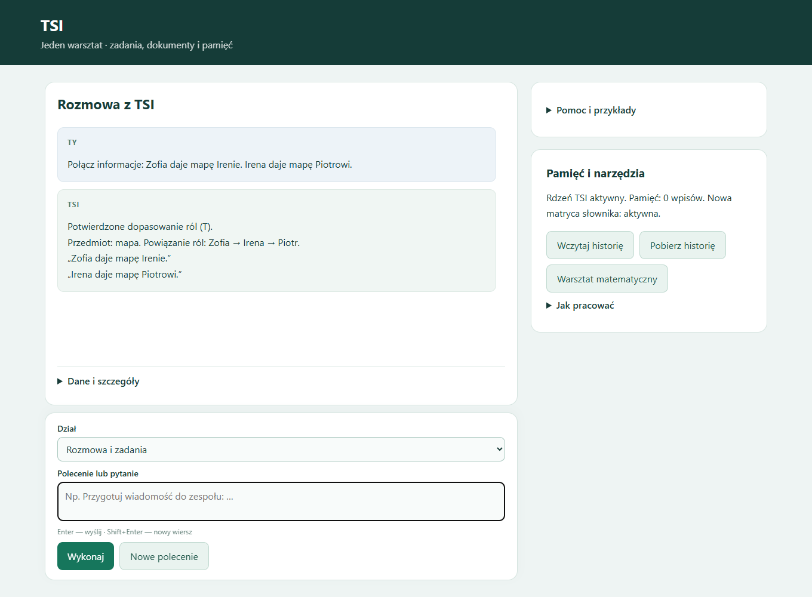

# TSI — lokalny asystent modułowy

**Aktualny stan: 18 października 2026.** TSI łączy własny uczony rdzeń, macierze językowe, trwałe notatki i narzędzia do pracy z tekstem, dokumentami oraz matematyką. Nowa aplikacja zastępuje wcześniejszy AI-SI; jego lokalna wersja została zachowana w archiwum.

Ta aktualizacja publikuje **wyłącznie dokumentację**. Kod nowego TSI, wagi, dane treningowe i prywatna pamięć pozostają lokalne. Starsze pliki znajdujące się już w repozytorium dotyczą wcześniejszego AI-SI, nie stanowią pakietu instalacyjnego obecnego TSI.

## Najnowsze wdrożenie — transformer kontekstu

W zwykłej rozmowie działa nowy moduł: **266 391 parametrów, 2 warstwy transformera, szerokość 128**. Odczytuje macierze ról i rozróżnia potwierdzenie, zaprzeczenie, brak informacji oraz sprzeczność. Współpracuje ze słownikiem odmiany, także dla imion i przedmiotów spoza treningu. Aktywny rdzeń H512 pozostaje bez zmian.

Przykład dwóch kolejnych wiadomości:

1. `Przeczytaj: Marek nie ma samochodu. Anna ma mapę.`
2. `Czy Marek ma samochód?`

Odpowiedź: „Nie — podany tekst temu zaprzecza”, z cytatem. Szczegóły pokazują przewidywanie sieci, audyt oraz ślad diagnostyczny. Zakres nowego modułu: 1–6 prostych zdań w kolejności osoba–ma–przedmiot; negacja zmienia wymagany przypadek. Pełne zdania złożone, generator swobodnej prozy i duży wariant 512/6 pozostają kolejnymi etapami.

W ograniczonym teście syntetycznym macierz ról dała **640/640**, a odczyt samych tokenów **306/640**. Dodatkowy stres: **512/512**. Zgodność osoby i przedmiotu podaje adapter; są to wyniki agregacji faktów, nie ogólnego rozumienia języka. Testy modułu **33/33**, regresja zmienionej rozmowy **65/65**. Pełna regresja poprzedniego stanu: **237/238**; pojedynczy nieudany przypadek przeszedł osobne powtórzenie **1/1**.

[Architektura, trening, ograniczenia i możliwość cofnięcia](docs/CONTEXT_TRANSFORMER_2026-10-18.md). [Poprzednia wersja README](docs/archiwum/README_2026-10-18_before_context_transformer.md).

## Co potrafi obecnie

| Obszar | Działające możliwości |
|---|---|
| Rozmowa i tekst | Utrzymanie kontekstu opracowywanego tekstu, przyjęcie brakującej treści w kolejnym kroku, przygotowanie wiadomości z podanej treści, skrót przez wybór zdań, punkty i listy zadań |
| Poprawki | Zamiana wskazanego fragmentu, cofnięcie ostatniej zmiany, rozpoczęcie nowego tematu |
| Czytanie | Pytania do podanego tekstu lub dokumentu, odpowiedzi z cytatem źródłowym |
| Dokumenty | TXT, MD, PDF i DOCX; do 10 plików, 8 MB na plik i 32 MB łącznie; skany wymagają wcześniejszego OCR |
| Pamięć | Jawnie zapisane notatki, wyszukiwanie informacji, lokalna historia rozmów i eksport JSON |
| Polski | Analiza odmiany, siedem przypadków, liczba, rodzaj i cechy czasownika; rozpoznawanie ról w obsługiwanych konstrukcjach |
| Kontrola znaczenia | Wykonawca, czynność, obiekt, odbiorca, przeczenie, aspekt, możliwość, czas i warunek; porównanie odpowiedzi z tekstem źródłowym |
| Kontrola zapisu | Wybrane błędy nawiasów, cudzysłowów, odstępów i pisowni; wskazanie wiersza i kolumny |
| Matematyka | Kalkulator naukowy, równania z x, pochodne, całki, upraszczanie i kontrola dziedziny; potęgi zapisane jako ^ lub ** |
| Zadania tekstowe | Współpraca z czytnikiem i solverem TSI-math-validator-5 w ich obsługiwanym zakresie |
| Logika i relacje | Fakty w trzech stanach, zachowanie faktów między pytaniami, relacje potwierdzane źródłem, ścieżki i wykrywanie konfliktów |
| Pozostałe narzędzia | Obliczenia na datach, odczyt udostępnionych plików i obsługiwanych stron HTTPS, katalog 10 sprawdzonych przykładów funkcji programistycznych |

## Matryce językowe i rdzeń

Aktywny rdzeń **H512** ma **2 054 186 parametrów**. Współpracuje z dodatkowym uczonym wyborem umiejętności oraz jawną kontrolą ról, kolejności działań i brakujących danych. Po rozbudowie matryc wykonano dalszy trening wag odczytu poleceń H512: odłożona ocena poprawiła się z **212/252 do 229/252**. Trening dotyczy siedmiu działań logicznych i kolejności argumentów. Pamięć, kontekst rekurencyjny i operacje wektorowe zachowano; nie jest to uruchomienie generatora opowiadań. Aplikacja nie korzysta z Bielika ani Qwena.

Lokalny analizator **Morfeusz/SGJP 1.99.15** dostarcza analizy fleksyjne. TSI zachowuje możliwe interpretacje form i stosuje rzeczywiste macierze reguł:

| Macierz | Wymiar | Zastosowanie |
|---|---:|---|
| Czasownik × przypadek dopełnienia | 58 × 7 | Wymagany przypadek w opisanych schematach |
| Czasownik × cechy ról | 58 × 3 | Dopełnienie, odbiorca, konstrukcja zwrotna |
| Przyimek × przypadek | 16 × 7 | Ograniczenia fraz przyimkowych |
| Przekształcenie przy przeczeniu | 7 × 7 | Zmiana wymagania biernika na dopełniacz w obsługiwanej konstrukcji |
| Część mowy × rola | 10 × 8 | Dopuszczalne funkcje składników zdania |

Przypadek, liczba i rodzaj pomagają ustalić role także po zmianie szyku: **„Oskarowi książkę daje Alicja”** wskazuje Alicję jako wykonawcę i Oskara jako odbiorcę. „Czytała” nie potwierdza „przeczytała”, a „może wysłać” nie potwierdza wysłania. Podział zdań, zakres przeczenia i warunki obsługuje osobny kontroler; nie sprowadzamy całego języka do jednego układu równań.

## Macierz kontekstowo-przyczynowa

W tej samej rozmowie działa:

```text
Macierz przyczynowa: Fakt: pada deszcz. Jeśli pada deszcz, to ulica jest mokra. Deszcz powoduje wzrost poziomu wody.
```

Przyczyny, reguły warunkowe, kolejność zdarzeń i wnioski zapisane w źródle mają oddzielne warstwy **T/F/U** z cytatami. Jawne konteksty, np. „W piątek:” i „W sobotę:”, pozostają rozdzielone. Natywna logika sprawdza aktywację reguł; fałszywa przesłanka nie staje się fałszywym następstwem, a sprzeczność zatrzymuje dalsze potwierdzanie.

Samo współwystępowanie zdań nie potwierdza przyczyny. Wskazana przyczyna nie jest automatycznie traktowana jako wystarczający warunek. Pytania i niepewne twierdzenia nie stają się faktami. Macierz zapisuje relacje podane w źródle; nie dowodzi ich prawdziwości w świecie.

Końcowe testy macierzy: **38/38**, ponadto wcześniej sprawdzono 68 przypadków nowego przepływu i poprzednich funkcji oraz siedem poleceń w przeglądarce. Zakres: opisane polskie łączniki, jawne konteksty, do 40 krótkich zdań i 24 węzłów. Pełne drzewa zdań złożonych oraz angielski czytnik pozostają do wdrożenia. Wybrany kierunek to wspólna reprezentacja znaczenia z osobnymi regułami PL/EN; translator może być opcjonalną pomocą.

Przy powtarzalnej utracie wcześniejszych umiejętności obowiązuje kontrola i zwiększenie pojemności właściwego modułu, trening z powtórkami oraz porównanie z zachowanymi wagami. Wymiana następuje po potwierdzeniu poprawy i zachowania wcześniejszych umiejętności; nie działa jako samoczynna wymiana wag podczas rozmowy.


## Wektorowe dopasowanie informacji — T/F/U

W rozmowie działa polecenie:

```text
Połącz informacje: Zofia daje mapę Irenie. Irena daje mapę Piotrowi.
```

TSI dopasowuje role i pokazuje „Zofia → Irena → Piotr” wraz z cytatami. Po wczytaniu tekstu można też zapytać `Jak łączą się te informacje?`. Pierwszy zakres obejmuje opisy przekazań, od 2 do 8 zdań; dopasowanie ról nie ustala chronologii ani tożsamości fizycznego przedmiotu.

Wartości czterech ról są wiązane w macierzy z 96-wymiarowymi wektorami istniejącego enkodera TSI. Uczony komparator rozróżnia **T — zgodność, F — niezgodność, U — brak rozstrzygnięcia**. Istniejąca natywna logika trójstanowa łączy te oceny. Możliwość, warunek i sprzeczności nie stają się bezwarunkowym potwierdzeniem. Oryginalne cytaty pozostają zachowane.

Odłożone porównania zakodowanych wartości: **1200/1200**, bez fałszywego T; natywne łączenie trzech stanów: **27/27**. To wyniki kontrolowanego porównywania wektorów i masek obecności, nie ocena dowolnej rozmowy. Cała aplikacja przeszła **200/200 testów**, obejmujących również zdania z różnym przedmiotem, przeczeniem, warunkiem i odwróconą kolejnością zapisu.



## Pełne odpowiedzi po treningu językowym

Do rozmowy włączono uczony moduł układania pełnych zdań, liczący **8736 parametrów**. Otrzymuje fragmenty tekstu z rolami rozpoznanymi przez matryce, uczy się ich kolejności i zachowuje oryginalne formy wyrazów. Każda propozycja przechodzi kontrolę zgodności ze źródłem. Przy błędnej propozycji użytkownika TSI może podać pełną wersję zgodną ze źródłem.

Przykład: „Zieloną książkę Oskarowi przekazuje Alicja” → pytanie „Komu Alicja przekazuje zieloną książkę?” → „Oskar. Alicja przekazuje zieloną książkę Oskarowi.” Oryginalny cytat pozostaje pod odpowiedzią.

Trening: 480 przykładów, 120 deweloperskich i 240 odłożonych; **240/240 poprawnie ułożonych zdań** w kontrolowanym zestawie z oznaczonymi rolami. W odłożonej części użyto innych nazw i czasowników. Ten wynik dotyczy układania rozpoznanych fragmentów, nie samodzielnego odczytu dowolnej polszczyzny. Nie jest to swobodne tworzenie opowiadań. Wagi H512 po poprzedniej rundzie pozostają aktywne; ta runda uczyła dodatkową część językową.


## Jak korzystać

W lokalnej instalacji uruchom **URUCHOM_TSI.bat**. Panel działa pod adresem **http://127.0.0.1:8791/**. **ZATRZYMAJ_TSI.bat** zamyka aplikację. Repozytorium nie udostępnia obecnie instalatora nowego asystenta.

**Enter** wysyła polecenie, **Shift+Enter** dodaje wiersz. Po udanym wysłaniu pole jest czyszczone; rozmowa pozostaje powyżej, a **Dane i szczegóły** poniżej. Rozwiń **Pomoc i przykłady** lub wpisz `pomoc` — dostępnych jest 28 przykładów. Wybranie przykładu wstawia treść do pola, bez automatycznego wykonania.

### Przykłady poleceń

| Polecenie | Cel |
|---|---|
| `Przeczytaj: Alicja daje zieloną książkę Oskarowi.` | Wprowadzenie tekstu źródłowego |
| `Komu Alicja daje zieloną książkę?` | Pytanie do tekstu z zachowaniem ról |
| `Czy Oskar daje zieloną książkę Alicji?` | Sprawdzenie zmienionego wykonawcy i odbiorcy |
| `Pokaż zależności` | Podgląd rozpoznanych relacji |
| `Pokaż macierze reguł` | Podgląd macierzy językowych |
| `Odmień: książka` | Formy słownikowe wyrazu |
| `Analizuj odmianę: książki` | Możliwe analizy podanej formy |
| `Sprawdź zdanie: Anna daje książka Markowi.` | Kontrola obsługiwanych zależności gramatycznych |
| `Sprawdź zapis: Anna czyta (książkę].` | Wskazanie problemu z zapisem |
| `zapamiętaj: termin projektu = 5 listopada 2026` | Zapis notatki |
| `przypomnij: termin projektu` | Odczyt notatki |
| `policz: 2*(7+3)^2` | Obliczenie wyrażenia |
| `x^2-13*x+40=0` | Rozwiązanie równania |

Do porównania treści użyj osobnych wierszy:

```text
Sprawdź znaczenie:
Źródło: Anna czyta zieloną książkę.
Odpowiedź: Anna czyta czerwoną książkę.
```

Zmiana koloru jest zmianą znaczenia i jest odrzucana w obsługiwanym schemacie.

## Potwierdzony wynik

Pełna regresja przed dodaniem macierzy kontekstowo-przyczynowej: **200/200 testów**. Nowa macierz ma osobne końcowe sprawdzenie **38/38** opisane powyżej. Obejmuje rzeczywisty rdzeń H512, narzędzia, dokumenty, pamięć, HTTP, morfologię, przypisanie ról, zapis i obliczenia macierzy. Eksport macierzy porównano z działającymi obliczeniami.

Dodatkowo przejrzano **26 rzeczywistych wypowiedzi w 10 rozmowach**. W przeglądarce sprawdzono sześć kolejnych poleceń, Enter, czyszczenie pola, szczegóły odpowiedzi oraz widok telefonu o szerokości 375 px. Nie stwierdzono błędów JavaScript ani poziomego przepełnienia. Próby odbywały się na osobnych danych testowych. Wynik regresji opisuje sprawdzone przypadki, a nie procent rozumienia dowolnego języka.

W odłożonej ocenie treningu pozostały **23 błędy na 252 polecenia**, w tym 14 dotyczących XOR. Na przykład „Proszę obliczyć xor A oraz B” nadal bywa odczytywane jako AND. W kontroli wcześniej poprawnie odczytanych poleceń nie wykazano utraty poprawnych odpowiedzi. Dodatkowo sprawdzono 1260 pełnych odpowiedzi; w 2048 próbach wektorowych wyniki pozostały identyczne. To kontrola określonych zadań, nie potwierdzenie uniwersalnego rozumienia języka.

## Co pozostaje do rozwinięcia

TSI jest rozszerzalnym asystentem o określonych umiejętnościach. Swobodne opowiadania i szerokie wyjaśnienia tematów pozostają do rozwinięcia. Osobny, eksperymentalny **prototyp generatora języka**, trenowany od zera, nie przeszedł oceny jakości i nie został wdrożony. Wynik tej próby dotyczy wyłącznie prototypu, nie aktualnego rdzenia H512 ani działających matryc i narzędzi TSI.

Pełny słownik odmiany nie oznacza pełnego rozumienia języka. Ograniczenia obejmują m.in. stronę bierną, część zdań złożonych, konstrukcje liczebnikowe, zależności między rzeczownikami i zaimki wymagające kontekstu. Niejednoznaczny odczyt pozostaje nierozstrzygnięty. Kontrola zapisu obejmuje wybrane reguły; zgodność z tekstem źródłowym nie potwierdza prawdziwości informacji o świecie.

Notatki są trwałą pamięcią użytkową, ale nie oznaczają automatycznego treningu wag podczas rozmowy. Listy zadań nie są autonomicznym harmonogramowaniem, a katalog przykładów kodu nie jest samodzielnym programowaniem.

## Historia i źródła

- [Poprzednie README — stan z 15 października 2026](docs/archiwum/README_2026-10-15.md).
- [Wcześniejsza historia AI-SI](HISTORIA_SI_2026-10-11.md) — dokument historyczny, nie bieżąca specyfikacja.
- [TSI-math-validator-5 — osobny warsztat matematyczny](https://github.com/jbackk-lang/TSI-math-validator-5).
- [Morfeusz/SGJP — opis](https://morfeusz.sgjp.pl/doc/about/) i [licencja oraz autorzy](https://morfeusz.sgjp.pl/doc/license/en).
- [RJP — zasady pisowni i interpunkcji](https://rjp.pan.pl/zasady-pisowni-i-interpunkcji-polskiej-2/).
