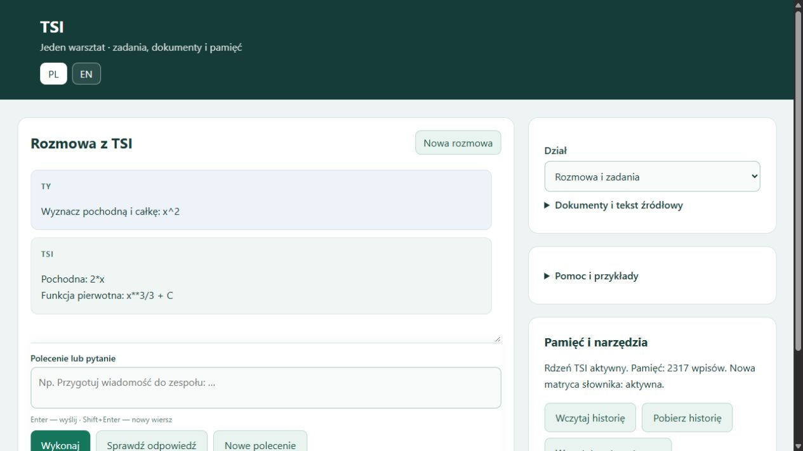
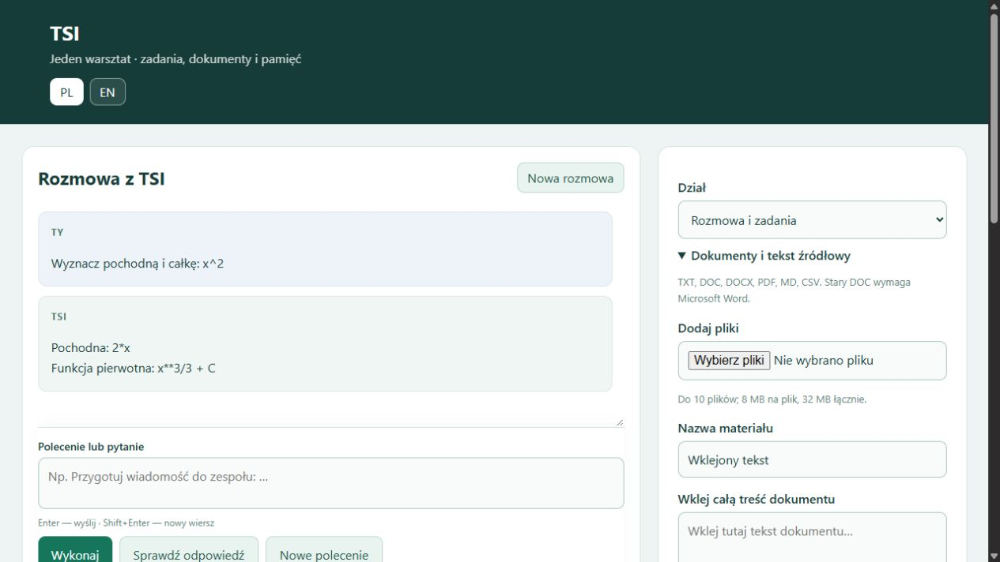

# AI-SI-TSI — lokalny asystent TSI

**Stan: 20 października 2026.** Własny uczony rdzeń, macierze językowe, trwałe notatki i narzędzia do pracy z tekstem, dokumentami oraz matematyką. Nowa aplikacja zastępuje wcześniejszy AI-SI, zachowany lokalnie w archiwum.

Ta aktualizacja publikuje **samą dokumentację**. Kod nowego TSI, wagi, dane treningowe, dokumenty i prywatna historia pozostają lokalne. Starsze pliki obecne już w repo dotyczą wcześniejszego AI-SI i nie są instalatorem obecnej aplikacji.

## Co działa

| Obszar | Dostępne możliwości |
|---|---|
| Tekst i rozmowa | Czytanie podanego materiału, pytania z cytatem, przygotowanie wiadomości z treści użytkownika, skróty i listy |
| Poprawki | Zamiana wskazanego fragmentu źródła, cofnięcie zmiany, wersjonowanie i nowy temat |
| Dokumenty | TXT, MD, CSV, PDF, DOCX i DOC; pliki lub wklejenie całej treści; do 10 plików, 8 MB na plik i 32 MB łącznie; DOC wymaga Worda, skany wcześniejszego OCR |
| Pamięć | Wspólny kontekst źródeł z pochodzeniem i wersjami, trwałe notatki, historia oraz eksport JSON |
| Matematyka | Arytmetyka słowna w obsługiwanym zakresie, kalkulator naukowy, równania, pochodne, całki, macierze i wykresy |
| Logika i język | Logika trójstanowa, analiza odmiany i ról, kontrola wybranych reguł zapisu oraz ograniczony czytnik PL/EN |
| Audyt odpowiedzi | Przycisk lub rozpoznana prośba o sprawdzenie poprzedniej odpowiedzi; ponowienie obsługiwanych obliczeń i kontrola cytatu w zapisanej wersji źródła |
| Inne narzędzia | Daty, lokalne pliki udostępnione do odczytu, wybrane strony HTTPS i katalog sprawdzonych przykładów programistycznych |

Główny rdzeń H512 ma **2 054 186 parametrów**. Współpracuje z dodatkowymi uczonymi modułami i narzędziami. Aplikacja nie korzysta z Bielika ani Qwena. Notatki i zwykła rozmowa nie uruchamiają samoczynnego treningu wag.

## Wspólny moduł matryc TSI 0.5 — stan aktualny

Matryca słownika oraz zależności „cel → wymagane dane” są zapisane jako wagi wspólnego checkpointu z transformerem relacji. Uczona warstwa przejść rozpoznaje role źródła/celu i negację. H512 pozostaje aktywny; jest to integracja części czytnika, a nie scalenie wszystkich wag H512.

Obsługiwane polecenia PL/EN mogą zawierać kilka celów, np. pochodną i całkę albo odwrócenie macierzy z kontrolą mnożeniem. Rozdzielono zakresy całki oznaczonej, nieoznaczonej i zanegowanej. Każdy wykonany krok ma sprawdzenie wyniku i zapis do ponownego audytu.

- **118/118** odłożonych kombinacji znanych pojęć i jawnych danych, bez błędnych akceptacji; **57/57** testów modułu.
- Wcześniejsze sprawdziany zachowane: **960/960, 720/720 i 640/640**. Dotychczasowy przepływ: **32/32**, w tym **24/24 akademickie**.
- **8/8** nowych kontroli obu paneli PL/EN oraz **7/7** wykonanych zadań matematyki, sygnału i projektu budżetu na danych syntetycznych.
- Słownik: 1596 form i 18 kategorii pojęć. Wagi słownika i wymagań przeniesiono dokładnie; uczono przejścia ról. Nieznane słowa i dowolne polecenia pozostają poza tym sprawdzianem.

Pamięć ma szybszy odczyt potrzebnych źródeł i ostatniej odpowiedzi oraz wspólny cache słownika. Notatki pozostają edytowalne i wersjonowane. Rozmowa i pole wpisywania znajdują się w jednym panelu, szczegóły pod nim, a wybór działu i dokumenty z boku.

[Zakres, trening, wyniki i ograniczenia](docs/TSI_MATRIX_CORE_2026-10-20.md). [Poprzedni stan i historia](docs/archiwum/README_before_matrix_weights_2026-10-20.md).

## Jak korzystać

W lokalnej instalacji uruchom **URUCHOM_TSI.bat**; panel: **http://127.0.0.1:8791/**. **ZATRZYMAJ_TSI.bat** zatrzymuje aplikację. Enter wysyła, Shift+Enter dodaje wiersz. Pomoc i przykłady są dostępne w panelu, a przełącznik PL/EN wybiera język odpowiedzi.

| Przykład | Zastosowanie |
|---|---|
| `Przeczytaj: Anna daje książkę Markowi.` | Wczytanie źródła |
| `Komu Anna daje książkę?` | Pytanie o rolę w tekście |
| `Zamień Markowi na Ewie` | Poprawka źródła; `Cofnij` przywraca poprzednią wersję |
| `Dodaj 3 plus siedem` | Obliczenie w obsługiwanym zakresie |
| `2/7` | Rachunek z zachowaniem wyniku dokładnego |
| `Sprawdź swoją poprzednią odpowiedź.` | Rozpoznana prośba o audyt; dostępny jest też przycisk |
| `zapamiętaj: termin = piątek` | Trwała notatka |
| `nowy temat` | Wyczyszczenie aktywnego kontekstu bez kasowania trwałych notatek |

Zgodny rachunek nie potwierdza dowolnej interpretacji polecenia. Kontrola cytatu potwierdza jego obecność w źródle; gdy dostępne kontrole nie wystarczają, odpowiedź pozostaje nierozstrzygnięta. Swobodne opowiadania i szeroka rozmowa nadal wymagają rozwoju.

## Analiza sygnałów — w treningu

Rozszerzono trening o logarytmy, odwrotności i pojedyncze piki. Nowy test pięciu etykiet na szerszych rodzinach: **95.32% micro-F1**, **1739/2000** pełnych zestawów; krzywe **1499/1500**. **Dostępny w panelu: „Sygnały ogólne — seria JSON”**, z opisem PL/EN i wykresem. W pomocy znajduje się gotowy przykład; potwierdzono 8 kontroli na działającym panelu. [Zakres, błędy i porównanie zachowania wcześniejszych umiejętności](docs/SIGNALS_2026-10-19.md).

## Podgląd

Aktualne zrzuty z 20 października 2026; rozmowa demonstracyjna bez prywatnych dokumentów.

## Rozmiar, pojemność i sprzęt — pomiar 20 października

| Moduł | Parametry | Plik wag |
|---|---:|---:|
| Językowy H512 | 2 054 186 | 8.55 MB |
| Wspólny transformer i matryce | 302 642 | 1.32 MB |
| Suma tych dwóch modułów | 2 356 828 | 9.87 MB |

Cały lokalny katalog TSI z kodem, danymi, kopiami i historią treningów: **432.31 MB**. Python poza katalogiem nie jest wliczony. To rozmiar plików; RAM, VRAM i aktualna kompletna paczka portable nie zostały tu zmierzone. Liczba parametrów nie określa limitu notatek.

Wspólny czytnik dobiera urządzenie i wątki na podstawie wykrytych możliwości oraz pomiaru. Na tym komputerze działa na **CPU**: Intel HD Graphics nie jest udostępniona przez zainstalowany PyTorch CPU. Ścieżki CUDA/MPS wymagają zgodnego środowiska; fizycznego GPU nie testowano. H512 i solvery pozostają na CPU. Panel walidatora ma jedno kontrolowane ponowienie po awarii procesu czytnika, z zachowaniem zapisanego postępu.

[Dokładny zakres pomiaru, sprzęt i ponawianie](docs/SIZE_HARDWARE_RECOVERY_2026-10-20.md). Wcześniejsze pomiary portable pozostają historyczne; nie wydano nowej paczki w tej partii.

- [Poprzednie README i pełniejsza historia rozwoju](docs/archiwum/README_2026-10-18.md).
- [Wcześniejsza historia AI-SI](HISTORIA_SI_2026-10-11.md).
- [TSI-math-validator-5 — osobny warsztat matematyczny](https://github.com/jbackk-lang/TSI-math-validator-5).
